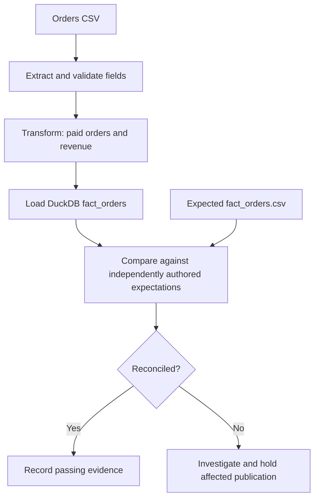

# ETL Quality Lab

### Testing Data Pipelines with BGSTM

**Follow the data. Challenge the transformations. Prove the result.**

> A successful ETL job does not necessarily mean trustworthy data. Quality engineering proves the difference.

  

## What you'll learn

- Differentiate pipeline execution success from data correctness.
- Design source-to-target checks using a business-owned expected result.
- Catch silent value defects even when every expected record arrives.
- Preserve evidence and make defensible quality decisions across BGSTM's six phases.

## Architecture



## Start in three commands

Requires Python 3.10+.

```bash
python -m pip install -e '.[dev]'
python -m pytest -q
python -m scripts.check --dataset clean
```

Now see a *business-correctness failure* that does **not** change the row count:

```bash
python -m scripts.check --dataset defective
```

The last command **intentionally exits 1** and reports a mismatch for `O-1002`; this is expected lab behavior. Normal CI validates that the defect is detected, so CI stays green.

## The scenario

A fictional retail company loads completed orders into a reporting warehouse. Its data contract requires paid orders only, one row per unique order ID, and revenue in integer cents to avoid floating-point ambiguity. The independently authored target expectations total **$120.00**. A deliberately corrupted source order increases reported revenue by **$12.50** without changing the row count. Synthetic examples only; not production financial data.

| Data set | Order count | Revenue | Quality decision |
| --- | ---: | ---: | --- |
| Clean | 3 | $120.00 | Pass |
| Defective | 3 | $132.50 | Hold affected publication; investigate |

## BGSTM learning path

| Phase | Evidence in this repo |
| --- | --- |
| Planning | [Test strategy](docs/test-strategy.md), risk statements |
| Test Case Development | [Source-to-target mapping](docs/source-target-mapping.md), pytest checks |
| Environment Preparation | Immutable, deterministic fixtures in `data/` |
| Execution | `python -m pytest -q` and command-line quality check |
| Results Analysis | [Defect investigation](evidence/defect-examples/ETL-005.md) |
| Results Reporting | [Sample quality decision](evidence/sample-test-report/quality-decision.md) |

**Begin with [Lab 01: reconciliation](labs/01-reconciliation/README.md).** For teaching tips, see the [instructor guide](docs/instructor-guide.md).

## Lab 02 — Transformation and business rules (v0.2)

A second, independently runnable lesson demonstrates **technical execution versus business correctness** using discount calculations, decimal precision, status normalization, invalid input handling, and an intentionally broken truncation rule.

- [Start Lab 02](labs/02-business-rules/README.md)
- [Reviewed transformation contract](docs/transformation-contract.md)
- [Synthetic defect investigation TR-002](evidence/defect-examples/TR-002.md)

```bash
python -m pytest -q tests/test_business_rules.py
```

The test suite expects to *catch* the seeded bug rather than running broken code in the normal pipeline. Lab 01 is preserved and still runs in the full suite.

## Lab 03 — Data integrity and schema drift (v0.3)

A standalone case study demonstrates how a consumer data contract distinguishes **compatible additive schema evolution** from **breaking schema changes**, while detecting duplicate keys, null required values, orphan relationships, and invalid amount types.

- [Start Lab 03](labs/03-integrity-and-schema-drift/README.md)
- [Data integrity contract](docs/integrity-contract.md)
- [Instructor notes](docs/instructor-guide-v0.3.md)
- [Investigation evidence INT-003](evidence/defect-examples/INT-003.md)

```bash
python -m pytest -q tests/test_integrity.py
```

Controlled negative fixtures are asserted as expected failures: the full CI suite stays green only when checks detect the violations. Labs 01 and 02 remain intact.

## Lab 04 — Incremental loads and recovery (v0.4)

A standalone exercise on **idempotent replay, version-aware upserts, atomic rollback, late-arriving records, and final-state reconciliation**. It uses the Python-standard-library SQLite engine to remain approachable.

- [Start Lab 04](labs/04-incremental-recovery/README.md)
- [Recovery contract](docs/incremental-contract.md)
- [Instructor notes](docs/instructor-guide-v0.4.md)
- [Incident analysis INC-004](evidence/defect-examples/INC-004.md)

```bash
python -m pytest -q tests/test_incremental.py
```

All earlier labs remain independently runnable and their acceptance criteria are preserved.

## Scope and limitations

This is an incremental teaching lab, not a production ETL framework. It deliberately omits orchestration, distributed compute, live cloud credentials, and large-dataset performance. `data/expected/fact_orders.csv` is authored independently of the ETL logic to avoid a circular oracle. The demonstration source is CSV for a fast start; additional source formats are future lessons. BGSTM is demonstrated as a methodology, not required as a software dependency.

## Next lessons (not implemented)

Misleading joins and duplicated revenue; and independent evidence packaging for release review.

## License

MIT (see `LICENSE`).
