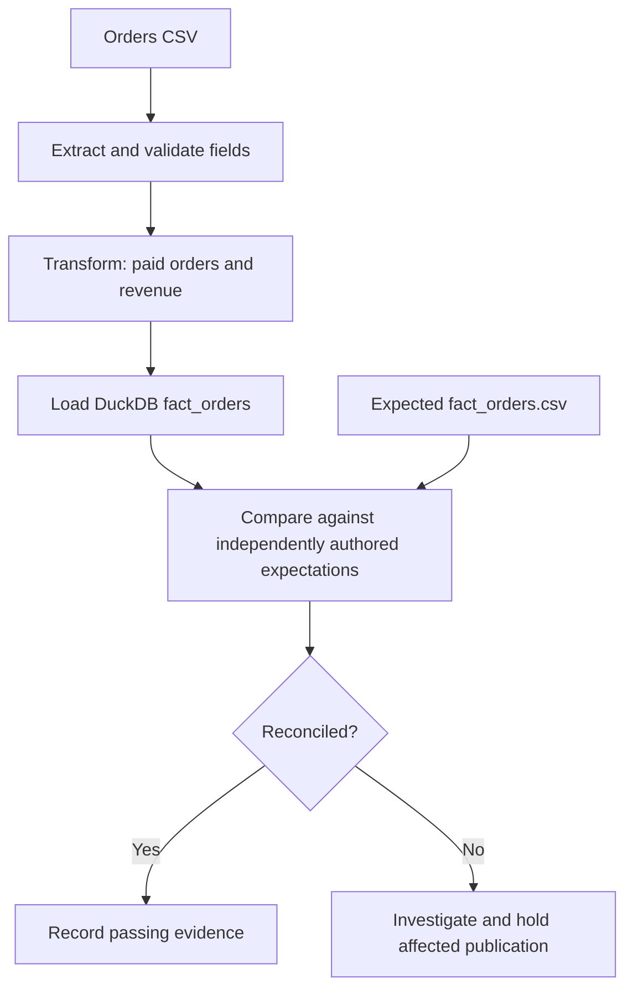

# ETL Quality Lab

### Testing Data Pipelines with BGSTM

**Follow the data. Challenge the transformations. Prove the result.**

> A successful ETL job does not necessarily mean trustworthy data. Quality engineering proves the difference.

  

## What you'll learn

- Differentiate pipeline execution success from data correctness.
- Design source-to-target checks using a business-owned expected result.
- Catch silent value defects even when every expected record arrives.
- Preserve evidence and make defensible quality decisions across BGSTM's six phases.

## Architecture



## Start in three commands

Requires Python 3.10+.

```bash
python -m pip install -e '.[dev]'
python -m pytest -q
python -m scripts.check --dataset clean
```

Now see a *business-correctness failure* that does **not** change the row count:

```bash
python -m scripts.check --dataset defective
```

The last command **intentionally exits 1** and reports a mismatch for `O-1002`; this is expected lab behavior. Normal CI validates that the defect is detected, so CI stays green.

## The scenario

A fictional retail company loads completed orders into a reporting warehouse. Its data contract requires paid orders only, one row per unique order ID, and revenue in integer cents to avoid floating-point ambiguity. The independently authored target expectations total **$120.00**. A deliberately corrupted source order increases reported revenue by **$12.50** without changing the row count. Synthetic examples only; not production financial data.

| Data set | Order count | Revenue | Quality decision |
| --- | ---: | ---: | --- |
| Clean | 3 | $120.00 | Pass |
| Defective | 3 | $132.50 | Hold affected publication; investigate |

## BGSTM learning path

| Phase | Evidence in this repo |
| --- | --- |
| Planning | [Test strategy](docs/test-strategy.md), risk statements |
| Test Case Development | [Source-to-target mapping](docs/source-target-mapping.md), pytest checks |
| Environment Preparation | Immutable, deterministic fixtures in `data/` |
| Execution | `python -m pytest -q` and command-line quality check |
| Results Analysis | [Defect investigation](evidence/defect-examples/ETL-005.md) |
| Results Reporting | [Sample quality decision](evidence/sample-test-report/quality-decision.md) |

**Begin with [Lab 01: reconciliation](labs/01-reconciliation/README.md).** For teaching tips, see the [instructor guide](docs/instructor-guide.md).

## Scope and limitations

This is a v0.1 teaching lab, not a production ETL framework. It deliberately omits orchestration, incremental loading, distributed compute, live cloud credentials, and large-dataset performance. `data/expected/fact_orders.csv` is authored independently of the ETL logic to avoid a circular oracle. The demonstration source is CSV for a fast start; additional source formats are future lessons. BGSTM is demonstrated as a methodology, not required as a software dependency.

## Next lessons (not implemented)

Transformation rule testing; schema drift and null integrity; incremental reruns and idempotency; misleading joins and duplicated revenue; and independent evidence packaging for release review.

## License

MIT (see `LICENSE`).
