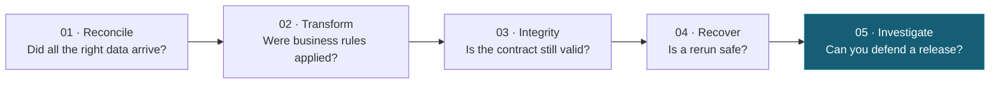
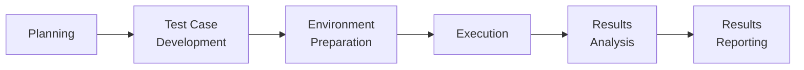

# ETL Quality Lab
### Applied data-pipeline testing through BGSTM

**Follow the data. Challenge the transformations. Prove the result.**

> A successful ETL run proves that a process executed. It does **not** prove that the business can trust its data.

    

**[Start learning](docs/learner-guide.md) · [Explore all five labs](docs/curriculum-map.md) · [BGSTM methodology](docs/bgstm-methodology.md) · [Investigation worksheet](docs/investigation-worksheet.md)**

---

## What is this?

ETL Quality Lab is a **five-lab, independently runnable teaching repository** for QA engineers, data engineers, analysts and instructors. It uses controlled fictional retail data to demonstrate why data quality requires requirements, deliberate test design, independent expected results, defect investigation and an evidence-based release decision.

There is no need to install BGSTM software. The labs **apply BGSTM's six-phase quality operating model** using Python, SQL-friendly data fixtures, DuckDB, SQLite and pytest. Every exercise connects a business risk to verifiable evidence.

## The learner journey



| Lab | Practical challenge | Start here |
| --- | --- | --- |
| **01 · Reconciliation** | Every row arrives, but revenue is wrong | [Open Lab 01](labs/01-reconciliation/README.md) |
| **02 · Business rules** | A rounding defect silently understates totals | [Open Lab 02](labs/02-business-rules/README.md) |
| **03 · Schema & integrity** | An upstream change breaks a downstream contract | [Open Lab 03](labs/03-integrity-and-schema-drift/README.md) |
| **04 · Incremental recovery** | A failed load is retried: is the final state correct? | [Open Lab 04](labs/04-incremental-recovery/README.md) |
| **05 · Investigation capstone** | Green job, wrong report: isolate multiple defects | [Open Lab 05](labs/05-incident-capstone/README.md) |

Each lab includes deterministic fixtures, acceptance criteria, negative-path checks and a documented investigation. You can start at any lab; the [learner guide](docs/learner-guide.md) supplies suggested timing, commands and a recommended workflow.

## Quick start

**Prerequisite:** Python 3.10+ and a terminal, from the repository root.

```bash
python -m pip install -e '.[dev]'
python -m pytest -q
python -m scripts.check --dataset clean
```

The first command installs the teaching dependencies. The second runs **all five labs**, including tests that assert seeded defects are detected. The last runs Lab 01's clean source-to-target quality gate.

**Try an intentionally failing data-quality check:**

```bash
python -m scripts.check --dataset defective
```

This command **should exit with status 1**: order `O-1002` raises the reported amount from $120.00 to $132.50, although the row count stays unchanged. That is an *expected learning outcome*, not a broken CI test.

## One quality model, six phases



| BGSTM phase | What the learner produces |
| --- | --- |
| **Planning** | A business-risk statement and release criteria |
| **Test Case Development** | Conditions, boundary cases, and independent expected values |
| **Environment Preparation** | Reproducible synthetic fixtures |
| **Execution** | Actual validation observations |
| **Results Analysis** | Expected-versus-actual discrepancies and supported hypotheses |
| **Results Reporting** | A defensible hold, release, or retest recommendation |

**Keep the tools you already use. BGSTM connects the quality evidence they produce.**

See the [illustrated curriculum map](docs/curriculum-map.md), [methodology notes](docs/bgstm-methodology.md), and [reusable investigation worksheet](docs/investigation-worksheet.md).

## How to teach or study with this repository

1. **Read the business contract** linked from your chosen lab.
2. **Predict the expected outcome** before running the code.
3. **Execute the checks** and separate technical execution from business accuracy.
4. **Investigate the data** and record verified observations separately from guesses.
5. **Make a quality decision** before opening the example report under `evidence/`.

Instructors can use the guides in `docs/instructor-guide*.md`. Suggested workshop sequencing and timings are in the [learner guide](docs/learner-guide.md).

## What this project does not claim

This is an **educational QA lab**, not a production ETL platform, full CDC framework, or universal data-quality guarantee. It uses synthetic data only, requires no production credentials, and does not provide cloud orchestration or distributed recovery. The capstone supplies incident evidence, **not** the actual buggy SQL, so some root causes remain hypotheses until confirmed. A passing pytest suite shows that the asserted detection behavior works—it does not certify every conceivable failure mode.

For extended teaching, future ideas include CSV structural edge cases, deployed schema-version compatibility, and evidence export. None are required to complete the five-lab curriculum.

## License

[MIT](LICENSE)
