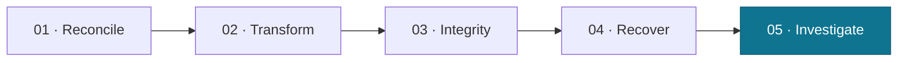
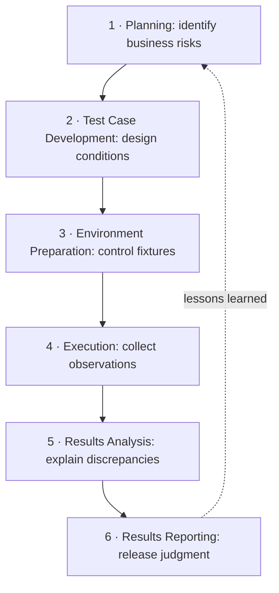

# Curriculum map — five labs, six BGSTM phases

Each lab exercises the complete BGSTM quality operating model. The scenarios increase in analytical difficulty, **not** in framework dependence.

## What builds from one lab to the next

| Lab | Primary risk | Distinct evidence | Quality decision |
| --- | --- | --- | --- |
| [01 · Reconciliation](../labs/01-reconciliation/README.md) | Missing or wrong amounts | Expected-vs-actual IDs, counts and totals | Reject inaccurate result |
| [02 · Transformations](../labs/02-business-rules/README.md) | Correctly executed but wrong business math | Rounding and discount oracle | Hold incorrect calculation |
| [03 · Integrity](../labs/03-integrity-and-schema-drift/README.md) | Breaking upstream changes and broken relationships | Schema and integrity finding codes | Accept compatible evolution; hold invalid extracts |
| [04 · Recovery](../labs/04-incremental-recovery/README.md) | Retry duplicates or partial commits | Before/after snapshots, versions, final oracle | Approve only verified recovery |
| [05 · Capstone](../labs/05-incident-capstone/README.md) | Material business overstatement | Multiple findings and causal hypotheses | Hold report, investigate, retest |

## BGSTM quality operating model

**Principle:** Keep the tools you already use. BGSTM connects the quality evidence they produce. An observed pipeline status is evidence of execution, **not** independently validated business truth.

## Suggested workshop format

Start with the [learner guide](learner-guide.md), run any one lab, require a [worksheet](investigation-worksheet.md), and discuss the model defect report only after learner assessment. For a multi-session course, teach in numerical order and finish with the capstone.
