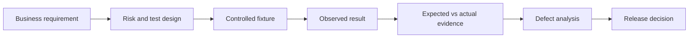

# Learner guide — from first test to release decision

**Audience:** QA engineers, data engineers, analysts, and instructors. Basic Python and CSV familiarity helps; each lab is independently runnable.

## 1. Setup

From the repository root, with Python 3.10+:

```bash
python -m pip install -e '.[dev]'
python -m pytest -q
```

The full suite covers all five labs. Test success means the *detection logic* behaved correctly, even when a deliberately defective fixture was detected.

## 2. Choose a lab

| Time* | Lab | Primary investigation | Run |
| --- | --- | --- | --- |
| 20–30 min | [01 · Reconciliation](../labs/01-reconciliation/README.md) | Correct row count, wrong dollars | `python -m pytest -q tests/test_reconciliation.py` |
| 20–30 min | [02 · Transformations](../labs/02-business-rules/README.md) | Bad rounding, discount rules | `python -m pytest -q tests/test_business_rules.py` |
| 20–30 min | [03 · Integrity](../labs/03-integrity-and-schema-drift/README.md) | Schema drift, orphaned relationships | `python -m pytest -q tests/test_integrity.py` |
| 25–35 min | [04 · Recovery](../labs/04-incremental-recovery/README.md) | Rerun and interrupted batch | `python -m pytest -q tests/test_incremental.py` |
| 30–45 min | [05 · Capstone](../labs/05-incident-capstone/README.md) | Successful job, incorrect report | `python -m pytest -q tests/test_capstone.py` |

*Times are suggestions for planning a workshop, not measured outcomes.

## 3. Work the problem before reading the answer

1. Read the business contract first.
2. Inspect source, observed output, and independently defined expectation.
3. Predict which validation should detect the problem.
4. Run the exercise and preserve the observed results.
5. Fill in the [investigation worksheet](investigation-worksheet.md).
6. Review the corresponding example in `evidence/defect-examples/` **after** making your own assessment.

## 4. Interpret failure correctly

- **Green pytest:** The asserted behaviors—including recognition of seeded defects—passed.
- **Lab 01 defective command exits 1:** The data-quality gate intentionally rejected inaccurate reporting. That is the expected lesson outcome.
- **A regression CI failure:** A required software/test behavior did *not* pass; investigate before approval.
- **Green job execution:** Does not independently establish business correctness.

## 5. Use the BGSTM evidence trail



See [BGSTM methodology](bgstm-methodology.md) and [curriculum map](curriculum-map.md).

## Scope

Synthetic datasets only. No production data, credentials, external services, or live cloud warehouse access is required. This project is an educational laboratory rather than a production-ready ETL or compliance product.
